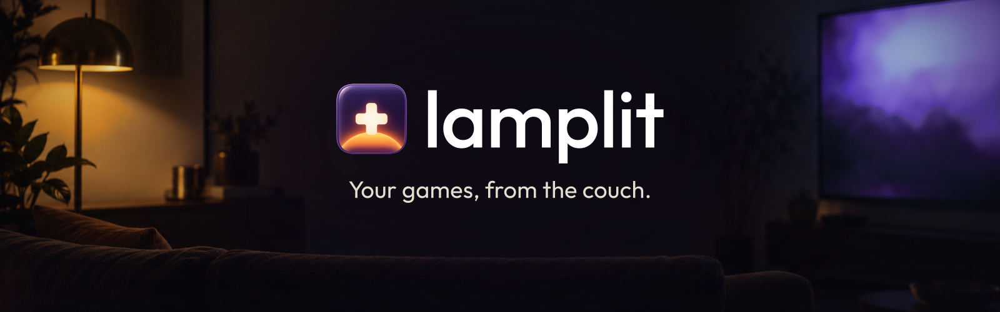
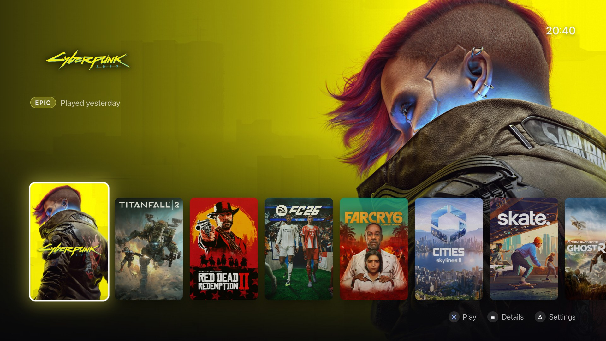
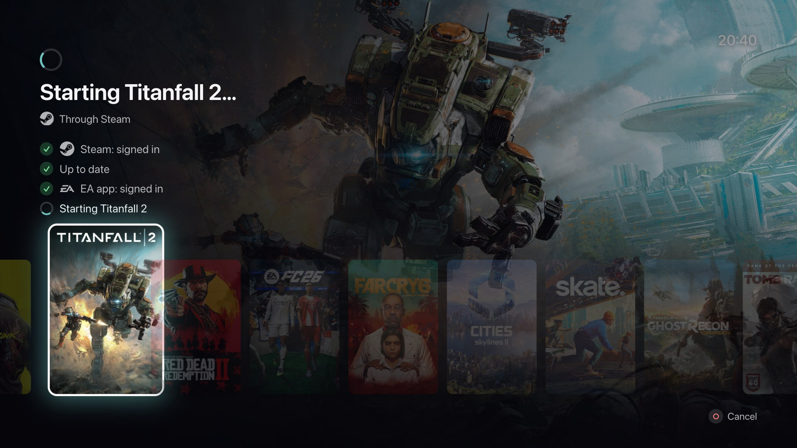
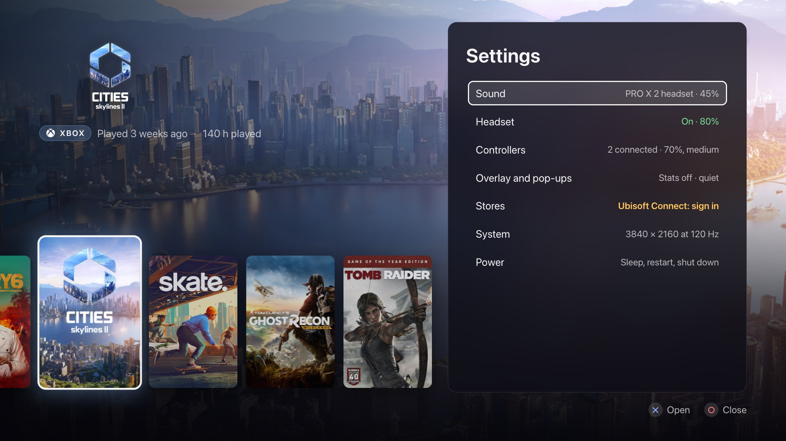
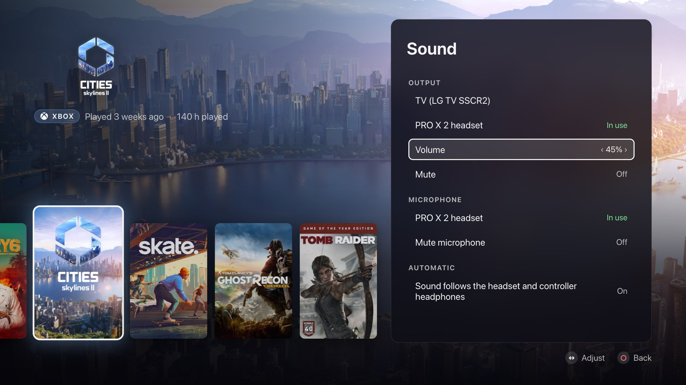
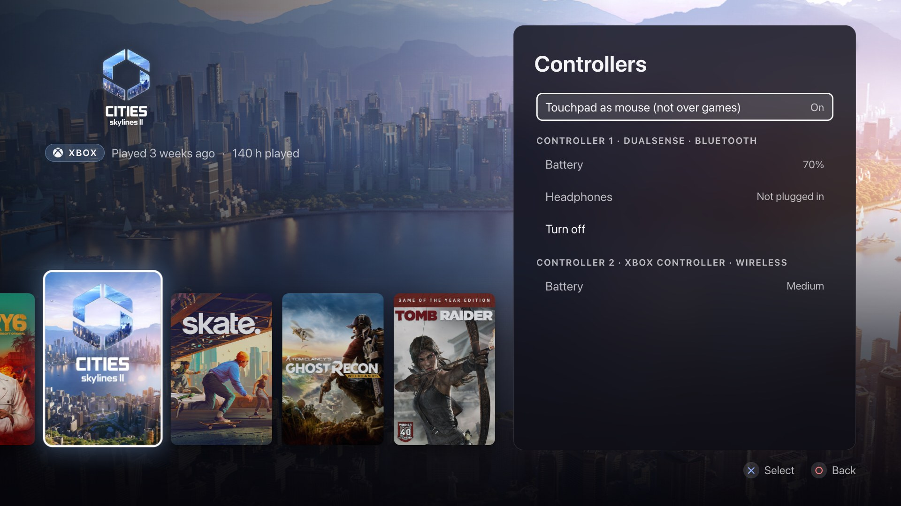
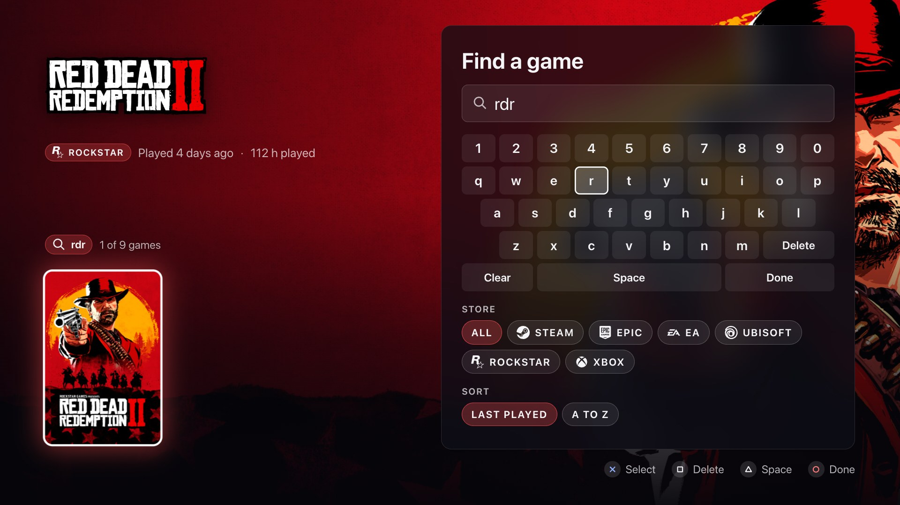
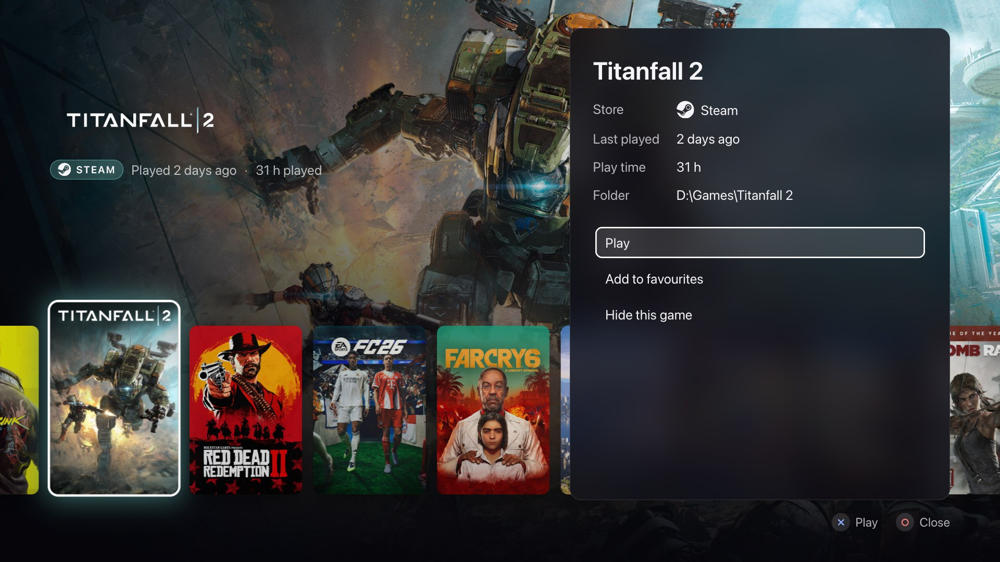

<p align="center">
  
</p>

<p align="center">
  <a href="https://github.com/YordiLorenzo/lamplit/actions/workflows/ci.yml"></a>
  <a href="https://github.com/YordiLorenzo/lamplit/releases/latest"></a>
  <a href="LICENSE"></a>
</p>

**Lamplit is a console-style home screen for the games on a Windows PC, made for the TV and a controller.**

A gaming PC under the TV usually comes with a handful of store apps, sign-in windows and Windows pop-ups, most of
them made for a mouse. Lamplit shows every game you have installed in one row of covers, whatever store it came from.
Press Cross and it starts the store apps the game needs, waits while they sign in or update, and gets out of the way
while you play. When the game closes, Lamplit is back on screen.

[Download for Windows](https://github.com/YordiLorenzo/lamplit/releases/latest) ·
[What it changes on your PC](docs/security-and-privacy.md) · [How it compares](#how-it-compares)



<table>
  <tr>
    <td width="50%"><br><sub>Starting a game: each store app it needs, and what it needs from you.</sub></td>
    <td width="50%"><br><sub>Settings: each section with a one-line summary.</sub></td>
  </tr>
  <tr>
    <td width="50%"><br><sub>Sound: output, microphone and volume, from the sofa.</sub></td>
    <td width="50%"><br><sub>Controllers: every controller, with its battery.</sub></td>
  </tr>
  <tr>
    <td width="50%"><br><sub>Find a game: "rdr" finds Red Dead Redemption 2.</sub></td>
    <td width="50%"><br><sub>A game's menu: its cover lifted, its details and choices beside it.</sub></td>
  </tr>
</table>

## What it does

### Your library

- **Every installed game in one row.** Lamplit reads what Steam, the Epic Games Launcher, GOG, the EA app, Ubisoft
  Connect, the Rockstar Games Launcher, Battle.net, the Amazon Games app, itch.io and the Xbox app have installed, and
  finds games outside any store too. There is nothing to import, connect or sign in to.
- **Favourites first, then last played,** then by name, so the game you're in the middle of is near the front.
- **A game's menu.** Options lifts the focused game's cover toward you and blurs the rest of the screen. Beside the
  cover are the game's store, when it was last played, its play time and folder, and its choices: Play, favourites,
  Change art and Hide this game.
- **Favourites and hidden games.** In a game's menu (Options), add it to your favourites to keep it at the front,
  or hide something Lamplit found that isn't a game. **Settings > Hidden games** shows a hidden game again.
- **Play time** for each game, on the home screen and in its details. For a Steam game it is Steam's own count, which
  includes play outside Lamplit. For other games it is the time Lamplit has seen the game running, from version
  0.2.0 on.
- **Find a game.** Square opens a search with an on-screen keyboard, and the row keeps only the games that match as
  you type. A search matches the start of any word in a game's name, or its first letters: "red dead" and "rdr" both
  find Red Dead Redemption 2. You can also show one store's games, or sort the row A to Z. Above the row, Lamplit
  shows what it is narrowed by, and Circle brings every game back.
- **Cover, background and logo art.** Lamplit takes it from Steam's own library cache when it can, and otherwise
  from Steam's public store, which it also searches by name for games from other stores. A game with no match shows
  its name instead. You can switch online art off.
- **Change art** when Steam's match is the wrong game. In a game's menu, Change art shows what Steam's store finds for
  the game's name as covers to pick from, and the lifted cover shows the one you are on. You can edit the search on
  the on-screen keyboard, or choose no art, which shows the game's name. **Back to automatic** undoes the choice. Lamplit
  keeps it through restarts and new scans.
- **Add a game by hand.** **Settings > Add a game** lists the installed programs Lamplit didn't take for games, and
  lets you browse the PC's drives and folders for a game's exe, all with a controller. Name the game on the on-screen
  keyboard, then choose its art. Lamplit starts it from its exe, as it does games outside any store, and its menu has
  **Remove from Lamplit**. When Lamplit finds no games at all, Cross on the empty home screen adds one.
- **New installs show up by themselves.** Lamplit looks again every time it comes back to the front.
- **Steam's install and update state** on the game: "Installing" or "Update pending".

### Launching

- **The store apps a game needs, started for you.** That is the game's own store, plus the launcher some publishers
  add on top: the EA app for some Steam games, Ubisoft Connect for others, the Rockstar Games Launcher for Rockstar
  titles. Lamplit starts each one and waits for it to sign in.
- **Sign-in and updates on screen.** If a store app isn't signed in, Lamplit says so and can open it for you, then
  carries on once you have signed in. A Steam update shows its progress before the game starts.
- **Out of the way while you play.** Lamplit minimises itself once the game runs and comes back when the game
  closes. A launcher that hands over to the game a few seconds after starting doesn't fool it.
- **Hold the PS button over a game for the dock,** or View and Menu together on an Xbox controller: see
  [The in-game dock](#the-in-game-dock). With the dock switched off, Lamplit itself appears over the running game;
  press Cross (A) to return to the game.
- **Awake while it waits.** The PC and the TV don't go to sleep while a store app starts or Steam downloads an
  update.
- **Steam stays in the background.** Lamplit closes Steam's Big Picture mode whenever Steam opens it, and minimises
  Steam's window after a Steam game.

### The in-game dock

- **Hold PS while you play** (or View and Menu on an Xbox controller) and a small dock rises from the bottom edge of
  the screen, over the game, rather than the whole home screen. It opens on Resume, so Cross (A) goes straight back.
- **What it holds:** Resume, the sound output, quiet mode, NVIDIA's performance stats when NVIDIA's overlay is
  installed, Home for the whole home screen, and Close game. Quiet mode and the stats light up when they are on. Above
  them are the game with its cover and how long you have been playing, the volume, each controller's battery and the
  headset's, and the time. Up goes to the volume, which opens into a slider: Left and Right change it, Cross mutes.
  The dock takes its colours from the game's art.
- **Close game:** hold Cross (A) until the ring around its icon is full, about a second. The game is then asked to
  close, as its own close button does, so it can save or ask you first. Let go earlier and nothing happens. A game
  that isn't responding, or still runs 10 seconds after you asked, gets **Force close** instead, held the same way,
  which ends it as Task Manager's End task does. Unsaved progress is lost.
- Circle (B), a second hold or Resume closes the dock, and the game is in front again.
- **News while you play:** the folded dock shows for a few seconds when the headset turns on or off, a controller
  connects or disconnects, or a battery runs low (15% or less). It doesn't take the game's focus, and clicks go
  through it.
- Switch the dock off in **Settings > Overlay and pop-ups**; holding PS then brings the whole home screen, as before.

How it works, and its limits:

- The dock is Lamplit's own window, transparent and above the game. Nothing is drawn inside the game, and no code
  goes into it.
- While the dock is open, it is the window in front, as the home screen is when you hold PS. Many games pause, or
  ignore the controller, while another window is in front, which keeps the presses you make in the dock out of the
  game. A game that reads the controller in the background still sees them. A dock that left the game in front
  would have every game see every press, so Lamplit doesn't do that.
- Windows shows no other window over a game in exclusive full screen. When Windows reports one, holding PS brings
  the home screen as before. For the dock, choose borderless or windowed full screen in the game's settings.
- A game that minimises or leaves full screen when another window comes in front does the same for the dock.
- Over a game that stopped responding, Windows may keep the game in front. The dock still opens, and the controller
  works in it, so Force close is in reach; the keyboard then still goes to the game.
- The dock is tested with a stand-in game window on Windows 11, and not yet with real games in each kind of full
  screen.

### Sound and accessories

- **Sound settings on the TV:** choose the output and the microphone, change the volume, mute either.
- **Sound that follows you.** Turn the PRO X 2 headset on and the sound moves to it. Plug headphones into a
  controller on a USB cable and the sound moves there. When they go, it moves back. This is on by default.
- **Headset settings, for the Logitech G PRO X 2 LIGHTSPEED only (for now):** whether it is on, its battery,
  sidetone (how much of your own voice you hear) and its auto-off timer. Other headsets work as normal Windows sound
  devices.
- **DualSense:** battery, whether headphones are plugged in, and Turn off for a controller on Bluetooth.
- **Xbox and other controllers:** name, connection and battery, as far as Windows reports them.
- **The touchpad as a mouse,** for store apps and Windows dialogs. One finger moves the pointer, pressing the left
  or right half of the pad clicks, two fingers scroll. Off by default, and never active over a full-screen game.
- **NVIDIA's performance stats** (frame rate, GPU and CPU load) on and off, when NVIDIA's overlay is installed.

### Quiet

- **Quiet mode** stops pop-ups over your games and over Lamplit: Windows' notification banners, tips and
  suggestions, Game Bar's start-up tips and controller button, Ubisoft Connect's notifications and overlay, and
  Steam's notifications (that part needs Steam's DevTools port, see
  [What Lamplit changes on your PC](#what-lamplit-changes-on-your-pc)). It also turns off Game Bar's recording.
  Switch it off and every setting goes back to what it was.

### Power

- **Sleep, restart and shut down** from **Settings > Power**. Press Cross once more to confirm; if a game is
  running, Lamplit names it first, since restarting or shutting down closes it. Apps get the chance to close, as
  with the Start menu.

### Screensaver

- **Art that moves while nobody plays.** After five minutes without a press on the controller, the keyboard or the
  mouse, while Lamplit is in front and no game runs, a screensaver covers the home screen, so a still picture can't
  mark an OLED TV. It draws its scenes live: three in 2D (draped silk, layered waves, coloured ink) and four in 3D
  (a desert at the end of the day, soft shapes that melt into each other, glass forms that bend the light behind
  them, an aurora over a lake). Every minute and a half or so the next scene blends in.
- **Coloured from your games.** Each scene takes its colours from the art of one of your games, favourites and the
  most recently played first, and that game's logo or name drifts faintly through it. Night scenes keep a deep blue
  dark, and no scene lets a yellow fade to olive.
- **Easy on the TV.** Nothing on it stands still, its average brightness is held down, and after an hour it fades to
  black. It draws at part of the screen's resolution and at most 30 frames a second, and stops the moment a game
  starts. Without WebGL2 it shows a slowly moving gradient instead.
- **The first press only ends it.** It never also moves the row or starts a game.
- **Settings > Screensaver** sets the delay (Off, 2, 5, 10 or 20 minutes) and the scenes (2D and 3D, only 2D, or only
  3D), and shows it now.

### Controller

- **DualSense, Xbox and other controllers,** several at once. Lamplit only reads a controller: it doesn't touch its
  lights, rumble or mode, so Steam and your games see it as before.
- **Hints in your controller's buttons:** PlayStation symbols on a PlayStation controller, A, B and Y on the others.
- **Console-style navigation:** a held direction repeats and speeds up, and L1 and R1 (LB and RB) jump five games at a
  time.
- **A keyboard and mouse work too.**

## Supported stores and hardware

### Stores

| Store | How Lamplit finds its games | Before the game starts |
| --- | --- | --- |
| Steam | The app manifest in each Steam library folder | Starts Steam, checks who is signed in, shows update progress |
| Epic Games Launcher | The launcher's install manifests | Starts the launcher, checks for a saved sign-in |
| EA app | The installer data every EA game carries | Starts the EA app, checks for a saved sign-in |
| Ubisoft Connect | The launcher's list of installs | Starts Ubisoft Connect, checks for a saved sign-in |
| Rockstar Games Launcher | The launcher's list of titles | Starts the launcher, checks for a saved sign-in |
| Battle.net | Battle.net's list of installed games | Starts Battle.net, waits for it to sign in, then asks it to start the game |
| GOG (GOG Galaxy or GOG's offline installers) | GOG's list of installed games | Nothing: GOG games start from their own exe |
| Amazon Games app | The app's list of installed games | Starts the Amazon Games app |
| itch.io (the itch app) | The itch app's list of installed games | Nothing: itch.io games start from their own exe |
| Xbox app, including PC Game Pass | The Xbox games installed for your Windows account | Nothing: Xbox games start without the app |
| No store | Folders in `<drive>:\Games`, installed programs that look like games, games Windows' Game Bar has seen, and games you add by hand | Starts the game's exe |

Steam says live who is signed in, and Battle.net's own log says whether it has signed in. For the other store apps
Lamplit checks whether they keep a saved sign-in, and if it can't confirm one, it lets you go ahead anyway. Lamplit
can't tell whether the Amazon Games app is signed in, so it starts the app and then the game, and the app asks you to
sign in if it needs to.

A Battle.net game starts with a code Battle.net doesn't keep on the PC, so Lamplit carries a list of them. For a game
newer than that list, Lamplit opens Battle.net on the game's page, and you press Play there.

Other stores aren't read yet. Their games can still turn up as games outside any store, but Lamplit then starts the
game's exe directly, which some of those games refuse.

### Controllers

| | DualSense | Xbox and Xbox-style | Other controllers |
| --- | --- | --- | --- |
| Buttons, d-pad and left stick | Yes | Yes | Yes, while Lamplit is in front (see below) |
| Open the dock over a running game | Hold PS for 0.6 seconds | Hold View and Menu for 1 second | No |
| Button hints | Cross, Circle, Triangle | A, B, Y | A, B, Y; PlayStation symbols on a Sony controller |
| Battery level | Over USB; over Bluetooth usually (see below) | A rough level, when wireless | When Windows reports it |
| Touchpad as a mouse | Over USB; over Bluetooth usually | No | No |
| Sound through the headphone jack | Over USB only | No | No |
| Turn off from Lamplit | Over Bluetooth only | No | No |

**DualSense and DualSense Edge,** over USB or Bluetooth, read over HID. Over Bluetooth, a DualSense sends its battery
level and touchpad only after a program has asked for its full reports. Steam usually has done this already. Lamplit
never asks itself: the switch lasts until the controller turns off, and older games that read the controller through
DirectInput stop working with it. The sound reaches the headphone jack only over USB, where the controller is a sound
device.

**Xbox controllers, and the many that work like one** (8BitDo, PowerA and others in their X mode), over USB,
Bluetooth or Microsoft's wireless adapter, read through XInput. The Xbox button belongs to Windows' Game Bar, so hold
View and Menu together to bring Lamplit forward. Windows reports only a rough battery level for them: empty, low,
medium or full.

**Other controllers** Windows knows, such as a DualShock 4, a Switch Pro Controller or a plain USB pad, are read
through Windows.Gaming.Input. Windows hands their input only to the window in front, so they move around Lamplit but
can't bring it over a game: use Alt+Tab or another controller. Windows names the buttons of only some of them; for
the rest Lamplit takes the order most of them use, the DualShock 4's. If yours confirms with the wrong button, please
open an issue with its name from Settings > Controllers.

While a Steam game runs, Steam Input adds a virtual Xbox controller for each controller it handles. Lamplit leaves
those out, since it reads the real one. Tools such as DS4Windows that add virtual controllers of their own can make
one controller count twice; hide the real one from other programs (HidHide does this) or close the tool.

The DualSense is tested over USB and Bluetooth. The DualSense Edge sends the same reports and is read the same way,
but hasn't been tested. Xbox and other controllers are new in this version and not yet tested on real hardware.

### Headset

One headset is supported for now: the Logitech G PRO X 2 LIGHTSPEED, through its USB receiver (USB id `046D:0AF7`).
Lamplit implements the receiver's protocol (Logitech's Centurion protocol) for it: it knows when the headset turns on
or off, reads the battery and charging state, and changes sidetone and the auto-off timer. It talks to the receiver
directly, so G HUB isn't needed, and both can run side by side. If something doesn't behave, an issue with the
`headset:` lines from `lamplit.log` helps.

Any other headset works as an ordinary Windows sound device: pick it in Settings > Sound. Support for more headsets
is welcome; [docs/accessories.md](docs/accessories.md) shows how the PRO X 2 protocol is handled.

### PC

- Windows 10 or Windows 11, 64-bit (x64).
- The Microsoft Edge WebView2 Runtime. Windows 11 includes it, and the installer downloads it from Microsoft when it
  is missing.

## Install

1. Download `Lamplit-setup.exe` from the
   [latest release](https://github.com/YordiLorenzo/lamplit/releases/latest).
2. Run it. The installer installs Lamplit for your Windows account only, by default into `%LOCALAPPDATA%\Lamplit`
   (the folder that also holds its settings, logs and art), and adds it to the Start menu. It doesn't ask for admin
   rights.
3. Start Lamplit, then run the [first-time setup](#first-time-setup) so it starts when you sign in.

### Windows warns about the installer

Lamplit's builds aren't code-signed yet, so Windows doesn't recognise the publisher:

- **Your browser** may say the file isn't commonly downloaded. In Edge, open the download's **...** menu, choose
  **Keep**, then **Show more** and **Keep anyway**.
- **SmartScreen** shows "Windows protected your PC" with "Unknown publisher". Click **More info**, then
  **Run anyway**.
- **Smart App Control**, if it is on, blocks unsigned apps and offers no way past. This build can't be installed
  while it is on. Switching it off (Windows Security > App & browser control) is a system-wide security change, so
  weigh it before you do.

Every new version starts with no reputation, so expect the same warnings when you update.

### First-time setup

Lamplit runs with your normal rights. Two jobs need admin rights, so it asks Windows once:

1. **A logon task** that starts Lamplit when you sign in to Windows. Registering a task that runs at sign-in takes
   admin rights.
2. **Steam's background service repaired** with Valve's own repair tool. Otherwise Steam stops to ask for admin
   rights when it updates that service, with a prompt you can't answer from the sofa.

Open Settings (Triangle or Y, or C on a keyboard), go to **System**, and choose **First-time setup**. Answer the Windows
prompt with a mouse or keyboard: it runs on a secure screen that a controller can't reach. You can also run it
from PowerShell opened as administrator; the pipe makes PowerShell wait and show what setup did:

```powershell
& "$env:LOCALAPPDATA\Lamplit\lamplit.exe" --setup | Out-Host
```

On a standard Windows account, the prompt asks for an administrator's password; the logon task is still made for
your own account. Without setup Lamplit works the same, but you start it yourself.

### Updating

Run the new version's installer and install into the same folder. Your settings, art and logon task stay.

### Uninstalling

First switch off **Quiet mode** and **Steam's DevTools port** in Settings: the uninstaller can't undo those. Then
uninstall Lamplit from **Settings > Apps > Installed apps**. Windows usually asks for admin rights to delete the
logon task.
[What Lamplit changes on your PC](docs/security-and-privacy.md#removing-lamplit) has the full list.

## Controls

| | DualSense | Xbox controller | Keyboard |
| --- | --- | --- | --- |
| Move along the row | D-pad or left stick, left and right | D-pad or left stick, left and right | Left and Right arrows |
| Jump five games | L1, R1 | LB, RB | Page Up, Page Down |
| Play the game, or return to it while it runs | Cross | A | Enter |
| Game menu | Options | Menu | I |
| Settings | Triangle | Y | C |
| Find a game | Square | X | F |
| Back, close, or cancel a launch | Circle | B | Esc or Backspace |
| Every game again, after a search | Circle | B | Esc |
| Return to the running game from the row | Circle | B | Esc |
| Open the dock over a running game | Hold PS for 0.6 seconds | Hold View and Menu for 1 second | |
| Bring Lamplit over a running game | Home in the dock, or hold PS with the dock off | Home in the dock, or hold View and Menu with the dock off | Alt+Tab |
| Close Lamplit | | | Alt+F4 |

Other controllers follow the same layout by position: the bottom face button plays, the right one goes back, the top
one opens Settings and the left one opens Find.

While a game starts, Cross (A) opens the store app that needs you, Triangle (Y) goes ahead without a confirmed
sign-in, and Circle (B) cancels. In Settings, Up and Down move, Cross or Right opens a section, Left and Right change
the volume, sidetone and auto-off timer, Circle goes back, and Triangle closes Settings. In Find, Cross types the key
or picks the choice you're on, Square (X) deletes, Triangle (Y) adds a space, and Circle closes Find on the games it
found. In the dock, Left and Right move along the row, Up goes to the volume, where Left and Right change it,
Cross does what the focused tile says (held, on Close game), and Circle goes back to the game. On a keyboard, type the name and press
Enter.

In a game's menu, Up and Down move and Cross picks; Circle or Options closes it. **Remove from Lamplit** asks first:
press Cross once more to remove the game. In Change art, the d-pad moves between the covers and the choices below
them, Cross picks one, Square (X) edits the search, and Circle goes back to the menu.

In Add a game, Up and Down move through the list, and L1 and R1 (LB and RB) jump eight rows. Cross or Right opens a
drive or folder; Circle or Left goes up a level. Cross on an exe or a program goes on to its name. The keyboard for a
name or a search works as Find's does, with two more keys: **Shift** switches the next letter between a capital and a
small letter (each word starts with a capital), and **Done** takes what you typed. Circle goes back without it.

With a mouse, click a cover to select it and click it again to play. Settings rows, the choices in a game's menu,
Change art's covers and Add a game's rows and keys take a click too. A click beside a game's menu closes it.

## What Lamplit changes on your PC

| Change | When | How to undo it |
| --- | --- | --- |
| A logon task, `lamplit-<your account's SID>`, that starts Lamplit at sign-in | First-time setup | The uninstaller deletes it |
| Steam's background service repaired with Valve's `SteamService.exe /repair` | First-time setup | Nothing to undo: it is Steam's own repair |
| Windows notification, tips and Game Bar settings; Ubisoft Connect's and Steam's notification settings | While quiet mode is on | Switch quiet mode off |
| The file `.cef-enable-remote-debugging` in Steam's folder, and Steam started with `-cef-enable-debugging` | While **Steam's DevTools port** is on (off by default) | Switch it off in Settings > Stores |
| Steam's **Guide Button Focuses Steam** turned off | Whenever Steam's DevTools port is open | Steam > Settings > Controller |
| Windows' default sound output and microphone | When the headset or controller headphones come and go (on by default) | Switch **Sound follows** off in Settings > Sound |
| Mouse input from the DualSense touchpad | While **Touchpad as mouse** is on (off by default) | Switch it off in Settings > Controllers |
| Prefs, favourites, hidden games, play time, the art you chose, the games you added, logs and art in `%LOCALAPPDATA%\lamplit` | Always | Tick **Delete the application data** when you uninstall |

Lamplit goes online only to fetch game art from Steam's store, and you can switch that off. No accounts, no
telemetry. [What Lamplit changes on your PC, and what it sends](docs/security-and-privacy.md) has every detail,
including the risk of Steam's DevTools port.

## How it compares

|  | Lamplit | Steam Big Picture | Playnite (fullscreen mode) |
| --- | --- | --- | --- |
| Price and source | Free, source on GitHub (noncommercial licence) | Free, closed source | Free, MIT licence |
| Runs on | Windows | Windows, macOS, Linux, SteamOS | Windows |
| Games it lists | Installed games from ten stores and outside any store, found by itself, and games you add by hand | Steam games; others as shortcuts you add by hand | Games from the libraries you connect through its add-ons, and emulated games |
| Before a game starts | Starts the store apps it needs, waits for sign-in, shows Steam's update progress | Steam updates its own games first | Starts the game through its store or its exe |
| Controllers | DualSense, Xbox and other controllers Windows knows; keyboard and mouse | Most controllers, through Steam Input | Many controllers, through SDL |
| Themes, add-ons, emulators | No | No themes or add-ons; emulators as shortcuts you add | Yes, with an add-on browser |
| Also does | Quiet mode, sound that follows the headset, PRO X 2 headset settings, NVIDIA stats switch | Store, friends and chat, Steam Input remapping, Remote Play | Metadata, filters and collections, play time |

Choose Big Picture if nearly everything you play is on Steam. Choose Playnite if you want themes, emulators, or a
library you shape yourself. Lamplit is for a TV PC that already has games in several stores and should show them all
without setup.

What comes next: [ROADMAP.md](ROADMAP.md).

## FAQ

### Does Lamplit replace Steam?

No. Steam games still start through Steam, which has to be installed and signed in. Lamplit only takes over Steam's
job as the big-screen interface: it closes Big Picture whenever Steam opens it, and with the DevTools port on, it
stops the PS button from opening Big Picture. You don't need Steam at all for games from other stores; art still
comes from Steam's public store website.

### Is it safe to use with anti-cheat?

Lamplit doesn't inject code into games, hook them or draw inside them. The in-game dock is a separate window that
Windows shows above the game. To know when a game starts and closes, Lamplit reads the list of running processes and
the folder each one runs from, as other launchers do. If a game's anti-cheat ever
objects to Lamplit, please open an issue.

### Which controllers work?

The DualSense and DualSense Edge, Xbox controllers and the many that work like one, and other controllers Windows
knows, such as a DualShock 4 or a Switch Pro Controller. A DualSense (hold PS) or an Xbox-style controller (hold View
and Menu) can bring Lamplit over a game; other controllers work only while Lamplit is in front. The headphone and
Turn off rows in Settings are a DualSense's. [Controllers](#controllers) has what each kind can do. Better support
for a controller you have is welcome: see [CONTRIBUTING.md](CONTRIBUTING.md).

### Why only Windows?

Most gaming PCs run Windows, and the EA app, Ubisoft Connect, the Rockstar Games Launcher and the Xbox app exist only
there. Lamplit is built on Windows' own interfaces: the registry where stores record their games, Task Scheduler,
Windows' sound devices and its Bluetooth stack. A version for another system would be a different program. On Linux,
SteamOS's game mode already does this job for Steam.

### Does it replace the Windows shell?

No. Windows starts as usual, and the logon task starts Lamplit after you sign in. If Lamplit crashes, it starts again
within seconds; after five crashes in two minutes it stops trying until the next sign-in.

### How do I stop it starting at sign-in?

Uninstall it, or open Task Scheduler as administrator and disable or delete the task `lamplit-<your account's SID>`.

### A game is missing, or shows up twice.

You can add a missing game by hand: **Settings > Add a game**. To help Lamplit find it by itself, please open an issue
with the store, the game's install folder, and the `discovery` lines from `lamplit.log`.

### Where are the logs?

In `%LOCALAPPDATA%\lamplit`: `lamplit.log` for the app, `supervisor.log` for the process that restarts it, and
`setup.log` for first-time setup. They name your games and their folders, so read them before you post one.

### Does it send anything online?

Only requests for game art to Steam's store, and only while **Find art online** is on: the names of games that
aren't from Steam, what you search for in Change art, Steam app ids, and your country. Details are in
[the privacy section](docs/security-and-privacy.md#network-art-only).

## Build from source

You need Windows, Rust 1.95 or newer with the MSVC toolchain, and the Visual Studio Build Tools.

```powershell
git clone https://github.com/YordiLorenzo/lamplit.git
cd lamplit\src-tauri
cargo build --release
```

That gives `target\release\lamplit.exe`, which runs without installing: the page is built into the exe. For the
installer, install the Tauri CLI and build the NSIS bundle:

```powershell
cargo install tauri-cli --version '^2' --locked
cargo tauri build --bundles nsis
```

The installer lands in `target\release\bundle\nsis\`. Cross-building from macOS or Linux, the tests and the code
layout are covered in [CONTRIBUTING.md](CONTRIBUTING.md) and [docs/architecture.md](docs/architecture.md).

## Contributing

Bug reports, games Lamplit misses, new stores, other controllers and headsets are all welcome.
[CONTRIBUTING.md](CONTRIBUTING.md) explains how to build, test and send a change. Please report security problems
privately, as [SECURITY.md](SECURITY.md) describes, not in a public issue.

## Support Lamplit

If Lamplit is how you start your games now, you can support it through
[GitHub Sponsors](https://github.com/sponsors/YordiLorenzo). Sponsorship pays for code signing, so Windows names the
publisher and each new version keeps the trust SmartScreen gave the last one. It also buys more headsets and
controllers for Lamplit to support, and time to work on it.

## Licence

Lamplit is free to use, change and share for any noncommercial purpose, under the
[PolyForm Noncommercial License 1.0.0](LICENSE). Playing games with it at home is exactly what it's for. Selling
it, or bundling it into something you sell, isn't allowed; for any commercial use, open an issue to ask.

It is built with [Tauri](https://tauri.app). The DualSense and headset code follows protocol notes published by
[HeadsetControl](https://github.com/Sapd/HeadsetControl), [Solaar](https://github.com/pwr-Solaar/Solaar),
[SDL](https://github.com/libsdl-org/SDL), [SpecialK](https://github.com/SpecialKO/SpecialK) and the Linux kernel's
`hid-playstation` driver; [docs/accessories.md](docs/accessories.md) lists the sources. The store logos come from
[Simple Icons](https://simpleicons.org) (CC0), and the Xbox logo from
[Material Design Icons](https://pictogrammers.com/library/mdi/) (Apache License 2.0). Neither has Amazon's logo, so
the Amazon Games app shows its name alone.

Lamplit is not affiliated with or endorsed by Sony, Valve, Microsoft, Logitech, NVIDIA, Epic Games, Electronic Arts,
Ubisoft, Rockstar Games, GOG, Blizzard Entertainment, Amazon or itch.io. Their names, logos and products are
trademarks of their owners and appear here only to say what Lamplit works with. Game art in the screenshots belongs
to its publishers.
